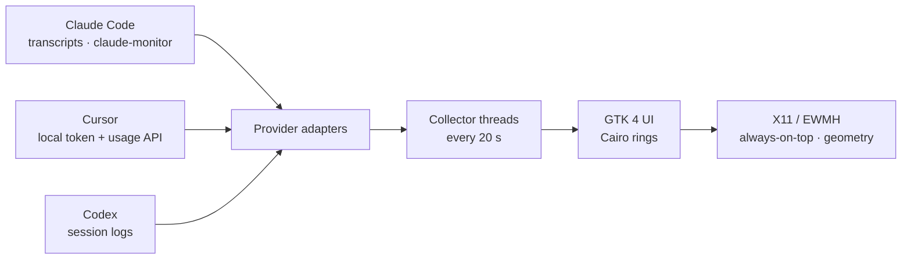

<div align="center">


# tokenmonitor

**A native Linux desktop widget that keeps your Claude Code, Cursor and Codex usage in sight — one glance, no browser tab.**

[](LICENSE)
[](#requirements)
[](https://www.gtk.org)
[](https://www.python.org)
[](https://github.com/aleinconnext/tokenmonitor/releases/latest)

[Overview](#overview) · [Features](#features) · [Screenshots](#screenshots) · [Installation](#installation) · [Usage](#usage) · [How it works](#how-it-works) · [Building](#building-from-source)

</div>

---

## Overview

If you work with more than one AI coding assistant, you know the routine: switch to a terminal, run `/usage`, read a wall of numbers, lose your train of thought. **tokenmonitor** removes that round trip.

It is a small, frameless GTK 4 widget that sits on the edge of your screen and renders one ring per assistant. Each ring shows how much of the current limit window you have burned, coloured by pressure (green → yellow → red). Hovering a ring reveals the complete picture: windows, resets, tokens, burn rate, plan and billing cycle.

The interaction model is intentionally physical. Drag the widget anywhere; when you release it near a screen edge it snaps into place and reorients itself — a horizontal strip along the top or bottom, a vertical stack along the left or right side. The position is remembered between sessions, so it is always exactly where you left it.

The design is inspired by [codenotch](https://github.com/vinzdg/codenotch) for macOS; tokenmonitor brings the same "ambient awareness" idea to the Linux desktop, with a dependency-light Python implementation and native X11/EWMH window control.

## Features

- **Three independent rings** — Claude Code, Cursor and Codex, each with its official brand glyph.
- **Colour-coded pressure** — green below 60 %, amber from 60 %, red from 85 %.
- **Details on hover** — limit windows, reset times, tokens used, burn rate, pace, context usage, plan and billing cycle.
- **Drag and snap** — release within 40 px of an edge and the window docks itself; side anchors switch to a vertical layout automatically.
- **Always on top** — undecorated, translucent, ARGB window that stays above normal windows and out of the taskbar.
- **Multi-monitor aware** — anchors to the monitor under the cursor and can be moved between displays from the menu.
- **Persistent state** — anchor, monitor, orientation and free position survive restarts.
- **Single instance** — launching it again simply raises the existing widget.
- **Privacy first** — reads local files, sends no telemetry, and makes exactly one outbound request (Cursor's own usage endpoint, with the token already stored on your machine).

## Screenshots

| Horizontal — top and bottom anchors | Vertical — left and right anchors |
|:--:|:--:|
|  |  |

> The widget is fully transparent around the card; the screenshots above are composited over a dark background so the rounded corners are visible.

## Requirements

| Requirement | Notes |
|---|---|
| Linux with GTK 4 | Tested on Zorin OS 18.1 (GNOME). Any GTK 4 desktop should work. |
| Python 3.10+ | Uses only the standard library plus PyGObject/PyCairo. |
| `python3-gi`, `python3-gi-cairo`, `gir1.2-gtk-4.0` | GTK bindings. |
| `wmctrl` | EWMH window control (always-on-top, taskbar skip, geometry). |
| X11 / XWayland | The launcher forces `GDK_BACKEND=x11`; GNOME does not expose always-on-top or absolute positioning to native Wayland clients. |
| *Optional*: `claude-monitor` | Supplies Claude Code limit windows. Without it the Claude ring shows `—`. |
| *Optional*: Cursor | The app reads the token from Cursor's local database. |
| *Optional*: Codex CLI | The Codex ring reads session logs written by the CLI. |

## Installation

### Option 1 — Debian package (recommended)

Download the latest `.deb` from the [releases page](https://github.com/aleinconnext/tokenmonitor/releases/latest) and install it:

```bash
sudo dpkg -i tokenmonitor_2.3.2_all.deb
sudo apt-get -f install   # resolves dependencies, if needed
```

Then launch **Token Monitor** from your application menu, or run `tokenmonitor` in a terminal.

### Option 2 — Per-user install (no root)

```bash
git clone https://github.com/aleinconnext/tokenmonitor.git
cd tokenmonitor
make user-install
```

This installs the app into `~/.local/share/tokenmonitor`, the launcher into `~/.local/bin/tokenmonitor` and a menu entry into `~/.local/share/applications`.

To start it automatically on login:

```bash
make autostart
```

### Option 3 — Run from the source tree

```bash
make run
```

## Usage

### Reading the gauges

- The **ring** is the percentage of the current limit window in use.
- The **icon** identifies the assistant; it dims when no data is available.
- The **percentage** sits below the ring and inherits the state colour.
- A small **reset hint** (time until the window resets) is drawn inside the ring.

### Moving the window

- **Drag anywhere on the card.** Movement is handled directly through X11 so the release event is never swallowed by the compositor.
- **Release near an edge** (within 40 px) to snap:
  - left or right → vertical layout, 138 × 390;
  - top or bottom → horizontal layout, 342 × 166;
  - somewhere in the middle → free position.
- **Right-click** for the menu: eight anchors, *Switch monitor*, *Always on top*, and shortcuts for the FreeLLMAPI dashboard and the `claude-monitor` TUI when those are available.

State is stored in `~/.config/tokenmonitor/state.json`.

## How it works



**Data collection.** Each provider is an independent adapter running in its own daemon thread; results are marshalled back to the GTK main loop with `GLib.idle_add`, so a slow network call never freezes the UI.

- **Claude Code** — invokes `claude-monitor --once --output json` for the five-hour and seven-day windows, then augments the tooltip with the newest local transcript (`~/.claude/projects/**/*.jsonl`) to estimate context usage.
- **Cursor** — opens `state.vscdb` read-only, reads the access token, and calls `DashboardService/GetCurrentPeriodUsage` with a 60-second cache.
- **Codex** — parses the newest session log under `~/.codex/sessions`, extracting `rate_limits` and token usage.

**Windowing.** The window is undecorated and uses an ARGB visual. Cairo draws the rings, text and glyphs. Dragging is implemented with `Gtk.GestureDrag` plus `libX11` (`XQueryPointer` / `XMoveWindow` via `ctypes`) because compositor-driven drags (`Gtk.WindowHandle`) do not deliver a reliable release event. Always-on-top and taskbar exclusion use EWMH through `wmctrl`.

**Layout.** Snap detection runs ~130 ms after release (giving the window manager time to apply the move), compares the real geometry against the work area, and switches orientation by rebuilding the gauge row.

## Data sources and privacy

| Assistant | Local source | Network |
|---|---|---|
| Claude Code | `~/.claude/projects/**/*.jsonl`; `claude-monitor` binary | — |
| Cursor | `~/.config/Cursor/User/globalStorage/state.vscdb` | `api2.cursor.sh` (usage endpoint) |
| Codex | `~/.codex/sessions/**/*.jsonl` | — |

The application has **no telemetry**, no analytics and no accounts. It never logs or prints tokens, and writes only `~/.config/tokenmonitor/state.json` (window geometry). The Cursor token is read from Cursor's own database and sent only to Cursor's API — the same destination Cursor itself uses.

## Building from source

| Command | Description |
|---|---|
| `make run` | Run the application from the source tree. |
| `make user-install` | Install into `~/.local` (no root). |
| `make autostart` | Add the app to the login session. |
| `make deb` | Build a `.deb` into `dist/`. |
| `make uninstall` | Remove the per-user installation. |
| `make clean` | Remove build artefacts. |

Packaging requires `dpkg-deb`; the resulting package is architecture-independent (`all`).

### Project structure

```
tokenmonitor/
├── src/tokenmon.py              # the entire application (single file)
├── packaging/
│   ├── control                  # Debian control file
│   ├── tokenmonitor             # launcher (forces GDK_BACKEND=x11)
│   ├── tokenmonitor.desktop     # desktop entry
│   └── tokenmonitor.svg         # application icon
├── scripts/build-deb.sh         # assembles and builds the package
├── docs/                        # banner and screenshots
├── Makefile
└── LICENSE
```

## Limitations

- **Codex** needs at least one session written by the Codex CLI; otherwise its ring stays muted.
- **Cursor** uses an undocumented endpoint of its own dashboard. It works today, but Cursor may change it at any time.
- **GNOME on Wayland** requires XWayland. Native Wayland intentionally forbids clients from positioning themselves or forcing always-on-top; the launcher handles the fallback for you.
- **Linux only.** codenotch remains the right choice on macOS.
- The interface strings are currently in Portuguese; internationalisation is on the roadmap.
- Tested on a two-monitor setup at 100 % scale; fractional-scaling reports are welcome.

## Roadmap

- [ ] English/Portuguese UI switch (gettext).
- [ ] Configurable thresholds and refresh interval.
- [ ] Cost estimates per provider.
- [ ] Optional tray icon and global shortcut.
- [ ] Wayland-native fallback using `gtk4-layer-shell` where available.

## Contributing

Issues and pull requests are welcome. The project is deliberately small and dependency-light: no frameworks, no bundlers, no runtime downloads. If you change the windowing code, please test on both X11 and XWayland sessions and include the desktop/compositor version in the report.

```bash
git clone https://github.com/aleinconnext/tokenmonitor.git
cd tokenmonitor
make run
```

## Acknowledgements

- [codenotch](https://github.com/vinzdg/codenotch) — the original macOS notch concept and the source of the provider glyphs.
- [claude-monitor](https://github.com/Maciek-roboblog/Claude-Code-Usage-Monitor) — Claude Code usage data.
- The Claude, Cursor and OpenAI/Codex marks are trademarks of their respective owners and are used only to identify the monitored products. See [THIRD_PARTY.md](THIRD_PARTY.md).

## Author

**Alessandro Gonçalves** — Software Engineer
[github.com/aleinconnext](https://github.com/aleinconnext)

## License

Released under the [MIT License](LICENSE).

Copyright © 2026 Alessandro Gonçalves.

---

<div align="center">
Built with GTK 4, Cairo and a healthy respect for the X11 protocol.
</div>
