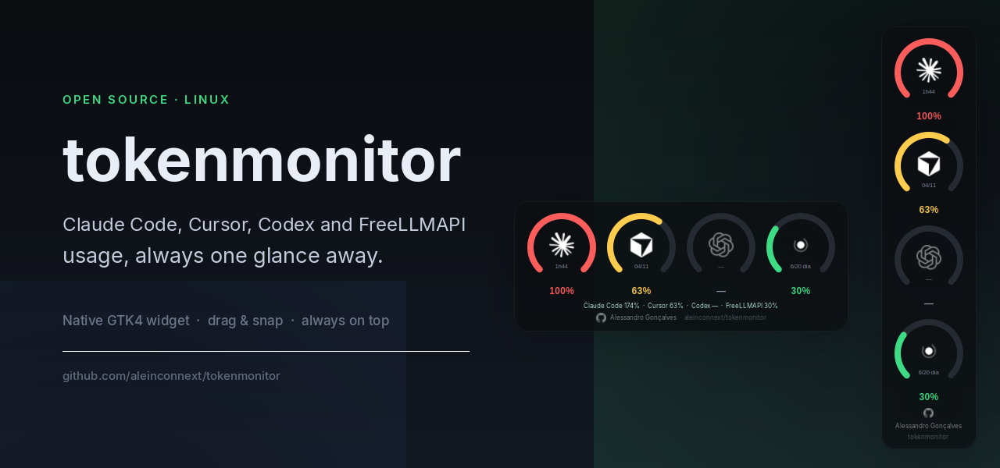
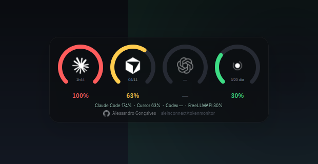
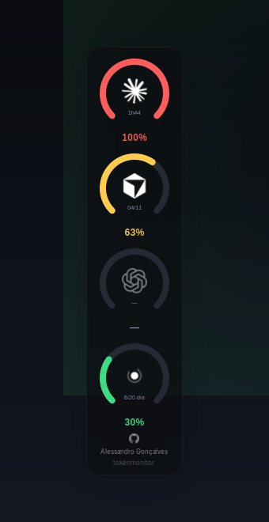
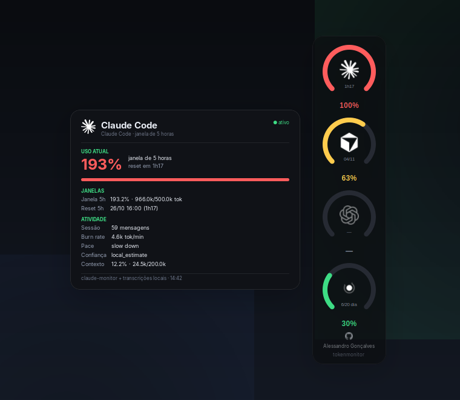
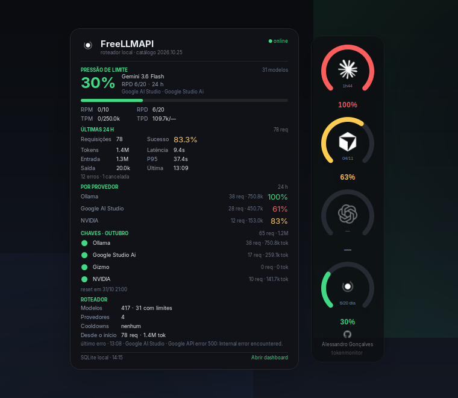
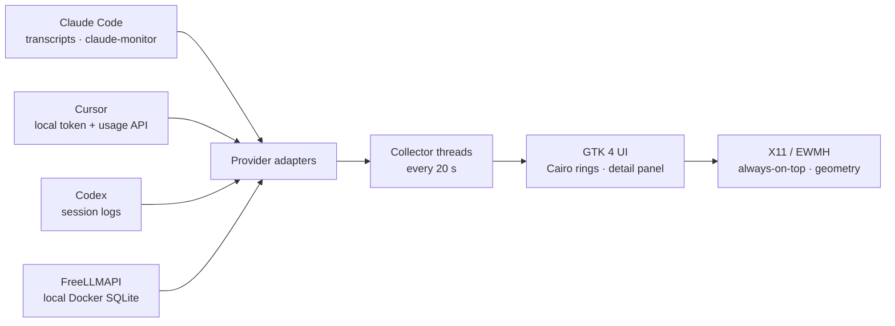

<div align="center">



# tokenmonitor

**A native Linux desktop widget that keeps your Claude Code, Cursor, Codex and FreeLLMAPI usage in sight — one glance, no browser tab.**

[](LICENSE)
[](#requirements)
[](https://www.gtk.org)
[](https://www.python.org)
[](https://github.com/aleinconnext/tokenmonitor/releases/latest)

[Overview](#overview) · [Features](#features) · [Screenshots](#screenshots) · [Installation](#installation) · [Usage](#usage) · [How it works](#how-it-works) · [Building](#building-from-source)

</div>

---

## Overview

If you work with more than one AI coding assistant, you know the routine: switch to a terminal, run `/usage`, read a wall of numbers, lose your train of thought. **tokenmonitor** removes that round trip.

It is a small, frameless GTK 4 widget that sits on the edge of your screen and renders one ring per assistant. Each ring shows how much of the current limit window you have burned, coloured by pressure (green → yellow → red). Hovering any ring opens the same kind of detail window: windows, resets, tokens, burn rate, plan and billing cycle, presented outside the widget so it never covers it.

The fourth ring follows a local [FreeLLMAPI](https://github.com/tashfeenahmed/freellmapi) router. It shows the highest rate-limit pressure among the models that can actually route — the worst RPM, RPD, TPM or TPD window across eligible keys. Its panel uses the same placement rules and visual shell as the other rings, adding the limiting model, provider, key label, 24-hour request health, latency, monthly usage, per-key budgets, cooldowns and catalog size. The panel is a separate always-on-top window positioned outside the widget's rectangle, so it never covers the widget itself.

The interaction model is intentionally physical. Drag the widget anywhere; when you release it near a screen edge it snaps into place and reorients itself — a horizontal strip along the top or bottom, a vertical stack along the left or right side. The position is remembered between sessions, so it is always exactly where you left it.

The design is inspired by [codenotch](https://github.com/vinzdg/codenotch) for macOS; tokenmonitor brings the same "ambient awareness" idea to the Linux desktop, with a dependency-light Python implementation and native X11/EWMH window control.

## Features

- **Four independent rings** — Claude Code, Cursor, Codex and FreeLLMAPI, each with its official brand glyph.
- **Colour-coded pressure** — green below 60 %, amber from 60 %, red from 85 %.
- **Detail panel on every ring** — a separate window opens beside, above or below the widget, never over it. Claude Code, Cursor and Codex show limit windows, reset times, tokens used, burn rate, pace, context usage, plan and billing cycle.
- **FreeLLMAPI's richer panel** — same placement rules and visual shell, plus the worst rate-limit window across routable models, 24-hour success, tokens, latency, p95, provider breakdown, monthly usage, per-key budgets, cooldowns and the current catalog.
- **Drag and snap** — release within 40 px of an edge and the window docks itself; side anchors switch to a vertical layout automatically.
- **Always on top** — undecorated, translucent, ARGB window that stays above normal windows and out of the taskbar.
- **Multi-monitor aware** — anchors to the monitor under the cursor and can be moved between displays from the menu.
- **Persistent state** — anchor, monitor, orientation and free position survive restarts.
- **Single instance** — launching it again simply raises the existing widget.
- **Private by design** — reads local files and the FreeLLMAPI SQLite inside its Docker container, sends no telemetry, and makes only one outbound request of its own (Cursor's own usage endpoint, with the token already stored on your machine). The FreeLLMAPI adapter queries only the local router at `127.0.0.1:3001` and never reads key secrets.
- **Discreet signature** — a small GitHub mark, the author's name and the repository path sit at the bottom of the card; hovering highlights it and a click opens the project on GitHub.

## Screenshots

| Horizontal — top and bottom anchors | Vertical — left and right anchors |
|:--:|:--:|
|  |  |

| Claude Code detail panel | FreeLLMAPI detail panel |
|:--:|:--:|
|  |  |

> The widget is fully transparent around the card; the screenshots above are composited over a dark background so the rounded corners are visible. Every ring opens a detail window on hover; all panels are placed outside the widget's rectangle.

## Requirements

| Requirement | Notes |
|---|---|
| Linux with GTK 4 | Tested on Zorin OS 18.1 (GNOME). Any GTK 4 desktop should work. |
| Python 3.10+ | Uses only the standard library plus PyGObject/PyCairo. |
| `python3-gi`, `python3-gi-cairo`, `gir1.2-gtk-4.0` | GTK bindings. |
| `wmctrl` | EWMH window control (always-on-top, taskbar skip, geometry). |
| X11 / XWayland | The launcher forces `GDK_BACKEND=x11`; GNOME does not expose always-on-top or absolute positioning to native Wayland clients. |
| *Optional*: `claude-monitor` | Supplies Claude Code limit windows. Without it the Claude ring shows `—`. |
| *Optional*: Cursor | The app reads the token from Cursor's local database. |
| *Optional*: Codex CLI | The Codex ring reads session logs written by the CLI. |
| *Optional*: Docker + FreeLLMAPI | The fourth ring reads the router's SQLite database from a running `freellmapi` compose container at `127.0.0.1:3001`. Without it the FreeLLMAPI ring stays muted and the panel explains what is missing. |

## Installation

### Option 1 — Debian package (recommended)

Download the latest `.deb` from the [releases page](https://github.com/aleinconnext/tokenmonitor/releases/latest) and install it:

```bash
sudo dpkg -i tokenmonitor_2.4.0_all.deb
sudo apt-get -f install   # resolves dependencies, if needed
```

Then launch **Token Monitor** from your application menu, or run `tokenmonitor` in a terminal.

### Option 2 — Per-user install (no root)

```bash
git clone https://github.com/aleinconnext/tokenmonitor.git
cd tokenmonitor
make user-install
```

This installs the app into `~/.local/share/tokenmonitor`, the launcher into `~/.local/bin/tokenmonitor` and a menu entry into `~/.local/share/applications`.

To start it automatically on login:

```bash
make autostart
```

### Option 3 — Run from the source tree

```bash
make run
```

## Usage

### Reading the gauges

- The **ring** is the percentage of the current limit window in use.
- The **icon** identifies the assistant; it dims when no data is available.
- The **percentage** sits below the ring and inherits the state colour.
- A small **reset hint** (time until the window resets) is drawn inside the ring.
- The **FreeLLMAPI ring** shows the worst pressure among models with an eligible key and a declared rate limit.
- **Hovering any ring** opens a detail window instead of a tooltip; the FreeLLMAPI panel is the richest one.

### Moving the window

- **Drag anywhere on the card.** Movement is handled directly through X11 so the release event is never swallowed by the compositor.
- **Release near an edge** (within 40 px) to snap:
  - left or right → vertical layout, 138 × 558;
  - top or bottom → horizontal layout, 444 × 183;
  - somewhere in the middle → free position.
- **Right-click** for the menu: eight anchors, *Switch monitor*, *Always on top*, and shortcuts for the FreeLLMAPI dashboard and the `claude-monitor` TUI when those are available.

State is stored in `~/.config/tokenmonitor/state.json`.

### The detail panel

Hover any ring. A separate window opens in the first safe direction: to the left or right of side-docked widgets, below a top-docked widget, or above a bottom-docked one; if that side is tight it falls back to any side with room. Claude Code, Cursor and Codex use the same shell and section layout; FreeLLMAPI keeps the same shell and adds its router-specific sections. The panel stays open while the pointer is over a ring or the panel, closes shortly after the pointer leaves, and hides while dragging or when the right-click menu is open. It is never placed over the widget; if the screen is too small for any safe position, it stays hidden. On short screens the panel scrolls instead of shrinking its content.

## How it works



**Data collection.** Each provider is an independent adapter running in its own daemon thread; results are marshalled back to the GTK main loop with `GLib.idle_add`, so a slow network call or Docker exec never freezes the UI.

- **Claude Code** — invokes `claude-monitor --once --output json` for the five-hour and seven-day windows, then augments the panel with the newest local transcript (`~/.claude/projects/**/*.jsonl`) to estimate context usage.
- **Cursor** — opens `state.vscdb` read-only, reads the access token, and calls `DashboardService/GetCurrentPeriodUsage` with a 60-second cache.
- **Codex** — parses the newest session log under `~/.codex/sessions`, extracting `rate_limits` and token usage.
- **FreeLLMAPI** — finds the compose container, runs a read-only `node:sqlite` query inside it with `docker exec`, and computes the worst `RPM`, `RPD`, `TPM` or `TPD` pressure across models that have an eligible key. The query returns aggregate counters and key labels only; secrets never leave the container. The container lookup is cached for 60 seconds and the query has a 12-second timeout.

**Windowing.** The window is undecorated and uses an ARGB visual. Cairo draws the rings, text and glyphs. Dragging is implemented with `Gtk.GestureDrag` plus `libX11` (`XQueryPointer` / `XMoveWindow` via `ctypes`) because compositor-driven drags (`Gtk.WindowHandle`) do not deliver a reliable release event. Always-on-top and taskbar exclusion use EWMH through `wmctrl`.

**Detail panel.** Every ring uses the same second undecorated `Gtk.Window` (not a popover), so the panel can live completely outside the widget's rectangle. A pure `panel_position()` function picks the first side with room and returns `None` when there is no safe placement. The window is mapped transparent and input-transparent, moved with `XMoveWindow`, and only then made visible and interactive — this avoids both a visible jump and the panel stealing hover from the gauge. A successful right-click closes the panel and keeps it suppressed until a fresh hover, so the menu never opens under a stale panel.

**Layout.** Snap detection runs ~130 ms after release (giving the window manager time to apply the move), compares the real geometry against the work area, and switches orientation by rebuilding the gauge row.

## Data sources and privacy

| Assistant | Local source | Network |
|---|---|---|
| Claude Code | `~/.claude/projects/**/*.jsonl`; `claude-monitor` binary | — |
| Cursor | `~/.config/Cursor/User/globalStorage/state.vscdb` | `api2.cursor.sh` (usage endpoint) |
| Codex | `~/.codex/sessions/**/*.jsonl` | — |
| FreeLLMAPI | SQLite database inside the local `freellmapi` Docker container | `127.0.0.1:3001/api/ping` only |

The application has **no telemetry**, no analytics and no accounts. It never logs or prints tokens, key secrets or prompts, and writes only `~/.config/tokenmonitor/state.json` (window geometry). The Cursor token is read from Cursor's own database and sent only to Cursor's API — the same destination Cursor itself uses. The FreeLLMAPI query returns counters, model names, provider names and non-secret key labels; it does not expose API keys.

## Building from source

| Command | Description |
|---|---|
| `make run` | Run the application from the source tree. |
| `make test` | Run the local smoke suite (syntax, GTK, providers, assets, package, window). |
| `make user-install` | Install into `~/.local` (no root). |
| `make autostart` | Add the app to the login session. |
| `make deb` | Build a `.deb` into `dist/`. |
| `make uninstall` | Remove the per-user installation. |
| `make clean` | Remove build artefacts. |

Packaging requires `dpkg-deb`; the resulting package is architecture-independent (`all`).

### Project structure

```
tokenmonitor/
├── src/tokenmon.py              # the entire application (single file)
├── packaging/
│   ├── control                  # Debian control file
│   ├── tokenmonitor             # launcher (forces GDK_BACKEND=x11)
│   ├── tokenmonitor.desktop     # desktop entry
│   └── tokenmonitor.svg         # application icon
├── scripts/build-deb.sh         # assembles and builds the package
├── docs/                        # banner and screenshots
├── Makefile
└── LICENSE
```

## Testing

Every change is validated on the development machine before it is published:

```bash
make test
```

The suite checks Python syntax, GTK 4 / Pycairo imports, headless collection from all four providers, the detail-panel placement rules at every screen edge, the README assets, the `.deb` build and its parity with `src/`, the per-user installation, and the live window geometry. Use `make test ARGS=--strict` to turn the installation-sync warning into a failure — that is the mode used before tagging a release.

The window check reuses a running instance when there is one and launches the app from `src/` otherwise, so it never disturbs an installed copy.

## Limitations

- **Codex** needs at least one session written by the Codex CLI; otherwise its ring stays muted.
- **Cursor** uses an undocumented endpoint of its own dashboard. It works today, but Cursor may change it at any time.
- **FreeLLMAPI** needs a running Docker compose container named `freellmapi` (or labelled `com.docker.compose.service=freellmapi`) with the router database at `/app/server/data/freeapi.db`. Only models that declare rate limits and have an eligible key contribute to the ring.
- **GNOME on Wayland** requires XWayland. Native Wayland intentionally forbids clients from positioning themselves or forcing always-on-top; the launcher handles the fallback for you.
- **Linux only.** codenotch remains the right choice on macOS.
- The interface strings are currently in Portuguese; internationalisation is on the roadmap.
- Tested on a two-monitor setup at 100 % scale; fractional-scaling reports are welcome.

## Roadmap

- [ ] English/Portuguese UI switch (gettext).
- [ ] Configurable thresholds and refresh interval.
- [ ] Cost estimates per provider.
- [ ] Optional tray icon and global shortcut.
- [ ] Wayland-native fallback using `gtk4-layer-shell` where available.

## Contributing

Issues and pull requests are welcome. The project is deliberately small and dependency-light: no frameworks, no bundlers, no runtime downloads. If you change the windowing code, please test on both X11 and XWayland sessions and include the desktop/compositor version in the report.

```bash
git clone https://github.com/aleinconnext/tokenmonitor.git
cd tokenmonitor
make run
```

## Acknowledgements

- [codenotch](https://github.com/vinzdg/codenotch) — the original macOS notch concept and the source of the provider glyphs.
- [claude-monitor](https://github.com/Maciek-roboblog/Claude-Code-Usage-Monitor) — Claude Code usage data.
- [FreeLLMAPI](https://github.com/tashfeenahmed/freellmapi) by Tashfeen Ahmed — the local LLM router whose pressure and usage the fourth ring reports. Its favicon inspired the monochrome ring glyph.
- The Claude, Cursor, OpenAI/Codex and FreeLLMAPI marks are trademarks of their respective owners and are used only to identify the monitored products. See [THIRD_PARTY.md](THIRD_PARTY.md).

## Author

**[Alessandro Gonçalves](https://github.com/aleinconnext)** — Software Engineer

<p align="center">
  <a href="https://github.com/aleinconnext/tokenmonitor" title="aleinconnext/tokenmonitor">
    
  </a>
</p>

## License

Released under the [MIT License](LICENSE).

Copyright © 2026 Alessandro Gonçalves.

---

<div align="center">
Built with GTK 4, Cairo and a healthy respect for the X11 protocol.
</div>
